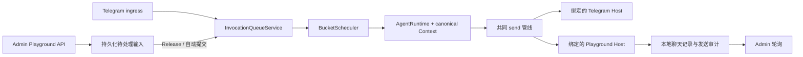

# Bot Playground — Architecture Decision Proposal

日期：2026-10-16。Epic：**Bot Playground & Minimal IM Host Abstraction**。

源码事实见[调查报告](20261016%20Bot%20Playground%20调查报告.md)，实施顺序见[Epic 与实施交接](20261016%20Bot%20Playground%20Epic%20与实施交接.md)。本文所有新类型、表、端点、文件和启动参数均为**拟议设计，尚不存在**；既有名称以调查报告的源码链接为准。

## 1. 决策摘要

推荐 **B：最小 Host Interface**，分小步提取现有共同边界，在同一 Store、Scheduler、AgentRuntime 中运行 Telegram 与 Playground。先保持 Telegram 现状，再加入真正独立的虚拟 Host。

MVP 采用默认 Hold、显式 Release、串行独立 Invocation 的确定性操作语义。Release 复用队列的快照与启动入口，不调用模型、不直接调用 `runtime.run`，也不通过 `ReplayRunner`。Playground 的手动批次不参与 Telegram collecting/debounce/send-barrier 策略。

只抽取两个实现已经需要的身份、输入投影、发送、activity、媒体来源和执行策略。不做通用平台协议、插件市场、任意 transport 注册、分布式 Scheduler、第二个真实 IM。

## 2. A / B / C 比较

| 维度 | A：直接复用，局部虚拟输入/输出 | B：最小 Host Interface（推荐） | C：完整 IM Adapter 架构 |
| --- | --- | --- | --- |
| 实现复杂度 | 原型低；可靠版本需处理越来越多隐式 Telegram 假设 | 中；集中处理已发现的实际边界 | 高；需设计尚无第二真实平台验证的协议 |
| 改动范围 | 假 Update/假 API 很少；真正隔离仍要改存储、Context、工具、启动 | Runtime 输入/策略、发送、受影响 schema/query、Admin、装配 | 几乎所有 IM 类型、协议、持久化与平台功能 |
| Telegram 回归风险 | 表面低，假 ID/全局状态串用风险高 | 中，可用原路径行为合同逐步约束 | 高，格式和功能迁移面过大 |
| Playground 交付 | 文本 demo 最快；可靠 Hold/媒体/恢复并不省多少 | 最快达到本需求的可靠 MVP | 最慢，Playground 被平台重构阻塞 |
| 可维护性 | 局部 if/playground 分支持续扩散 | 有两个真实实现验证的窄边界 | 理论统一，但容易泛化出错误能力假设 |
| 第二真实 IM 成本 | 通常要重做身份、媒体、输出错误模型 | 继续扩展真实需要的缺口 | 预付大量成本，仍可能需要改协议 |

A 可作为测试里的 fake transport，但不接受把虚拟房间写入 `telegram.chats`、伪造 Telegram ID、调用 Telegram ingestion 来当产品实现。C 留在 P2，且必须由一个具体平台的需求重新驱动。

“最小”不等于只改一个接口：当前非空 Telegram 列、硬编码配置准入与全局休眠都是真实阻塞，需要在 P0 处理。无需把所有 Telegram 专有行为搬成统一协议。

## 3. MVP 的可见范围

### 必须交付

- `/playground` 页面；创建/选择虚拟群聊，默认 Hold。
- 每群多个虚拟身份，名称可重复但身份不同；选择身份逐条发送/粘贴文本；服务端确认后立即出现在聊天记录。
- Reply 只能选择本群已存在消息，保存稳定内部目标与显示快照。
- Hold / Release、待处理数量、排队/运行/终态/错误、失败原因与安全重试结果。
- 文本和 `send_reply` 的真实工具输出；静态图片输入与生成图片输出。生成能力默认关闭，管理员明确启用后才允许真实付费生成。
- 不支持的媒体显示明确类型/原因，不伪造成功。普通文件、音视频和 Telegram Sticker 完整仿真不进 P0。
- 单进程共存与无需 Telegram 网络/凭据解析的 Playground-only 启动。

### 不纳入 MVP

批量 Eval、自动评分、自动造数据、可编程时间、任意历史编辑、模型私有文本当聊天消息、第二真实 IM、共享房间权限系统、WebSocket/SSE、全工具 Mock。

MVP 允许输入的历史按粘贴顺序构造，并作为本次 Release 的新批次交给模型。只作为背景、不形成新任务的 seed/import 模式放到 P1；不会在 P0 用一个含糊的“历史”按钮改变触发语义。

## 4. 三层概念与最小边界

### 4.1 通用数据模型：只表达已知事实

以下是边界概念，不要求逐个建立 class 或 service：

| 概念 | P0 所需信息 | 不假定 |
| --- | --- | --- |
| Conversation | 内部 conversation/chat ID、`hostKind`、private/group、显示名称 | 每个 Host 都有 Telegram Forum Topic |
| Participant | 内部 sender ID、当前会话可见 ref、名称、可选用户名、human/bot | 所有用户都有数值平台 ID 或用户名 |
| Message | 内部 ID/revision、发送者、文本/caption、媒体、Reply、事件时间与接收顺序 | 平台消息 ID 全局唯一或可按数值排序 |
| Message Reference | opaque string → 本 Conversation 内部消息目标 | 模型传入字符串就是授权；引用可跨房间 |
| Media | 内部 media/asset ID、类型/MIME/大小、校验后的来源 | 所有媒体都有 Telegram file ID，或都能直接发送 |
| Activity State | 可选 typing 状态及到期时间 | 状态可靠、永久存在、等同已发消息 |

内部主键继续 bigint，JSON 继续字符串。Telegram 的外部 chat/message/user ID 保留在其映射和投影中；Playground 用真实内部身份，不创造 Telegram ID。

模型看到的 Telegram message/uid 文本维持现状；Playground 可用 `pmsg_<id>` / `puser_<id>` 作为 opaque ref。公共 resolver 不再 `BigInt` 所有 reply 输入；Telegram 边界继续校验其数值引用。字段名 `reply_to_message_id` 可保留以降低工具契约变动，但其宿主允许值由 capability 校验，而非“任意平台 ID”。

### 4.2 IM Host capabilities/actions：绑定目标，不接受任意目标

拟在 `src/platform/im-host.ts` 定义窄契约，由组合根选择两个具体实现。调用 `bind(conversationId, snapshot)` 的效果应得到一份本次运行固定的绑定：

- identity：内部作用域、Host 类型、Bot 身份、群/私聊模式。
- capabilities：当前支持的文本格式、reply、图片、Sticker、typing；不做未来能力大清单。
- actions：已绑定目标的 `deliver` 和可选 activity；模型不能提供 chat ID、topic ID 或 Host 类型。
- media source：根据经过授权的内部 media ID 提供本地/Telegram 媒体读取。
- conversation policy：准入、模型/prompt/timezone、budget scope、可用工具与 Skills、调度模式。

这些名字是建议；可以用一份接口和几个小函数，不建通用服务定位器。声明应是类型/小值，不能导入 grammY、数据库 adapter 或文件 I/O。实现放在宿主装配边界；业务层不反向导入 `adapters/local-monolith`。

Telegram 实现继续负责 MarkdownV2、MessageEntity、`tg://` mention、thread/reply 参数、429/5xx/网络结果分类、Sticker、migration 和命令。Playground 实现负责本地消息交付与资产引用；未知 Host、能力不支持、跨房间目标一律明确拒绝，绝不 fallback 到 Telegram。

### 4.3 Runtime 业务原语：继续只有一套

保留 `read/send/send_reply/execute/zzz` 的业务分层。`send` 的授权、限流、去重、deadline、成功判定、审计和多 part 处理继续共享；将传输专属映射移出。`zzz` 是否注册由执行策略决定，Playground 不注册。

`ConversationContextStore` 仍是唯一 canonical writer；`ConversationRuntime` 仍负责缓存和握手；Scheduler 仍唯一负责 queued → running、并发和终态。不为 Playground 建另一套 Agent loop。

## 5. 存储演进：复用主库，不用假 ID

### 5.1 共享身份与历史的增量变化

建议沿用 `chats/conversations/senders/messages/message_revisions/media`、Bucket/Invocation/Context 表。新增 migration 与 Drizzle 声明必须一起提交：

1. `chats.host_kind`，旧行回填 `telegram`。允许虚拟行的 Telegram 专属标识为空；Telegram 写边界仍强制真实 ID。
2. Sender 的 Telegram type/id、Message 的 Telegram ID/date、Media 的 Telegram file metadata 对非 Telegram 行允许空。保留真实 Telegram metadata 的列名与现有唯一性；不把同一列重新解释成两种 ID。Telegram 特有 CHECK 需改为条件约束；跨表约束用写事务验证。
3. Playground 专有的 room 设置（hold、revision、图片授权）、participant membership、输入序号/显示时间/内部 reply 目标放入少量 `playground_*` 扩展表。普通内容仍在共享 Message/Revision 表中，扩展表不再存第二份文本。
4. `invocation_messages` 增加显式 snapshot format：旧行 `telegram-v1`，Telegram 继续写原格式，Playground 写 `playground-v1`。两个边界 decoder 都校验并投影到共同 Message view；这表示两个真实输入格式，不是隐式旧格式 fallback。不改写历史审计 JSON，也不保留两条 runtime 主流程。
5. 共享 Context/消息视图用中性字段；Telegram 专属 rendering/prompt fragments 保持现有字节内容，避免无关稳定 prompt hash 变化导致 Context 重建。

不在 P0 统一所有平台外部 ID 成一个通用地址数据库。Host-specific metadata 暂留现表是有意取舍，核心读取通过已校验投影进入中性模型。

SQLite 对 nullable/约束的变更可能需要重建表；必须验证当前 migrator 的事务、FK、索引、旧行计数与备份恢复，不允许以关 FK 后忽略检查来交付。迁移前自动备份已经存在。数据库改变后不可仅降级可执行文件当作回滚。

### 5.2 一份发送台账

将 `telegram_sends` 有控制地迁为中性的 `host_sends`（名称拟议），保留原 ID、FK、状态、回复/图片去重索引和真实 Telegram response metadata；增加虚拟出站消息的关联。所有运行查询、`imageDeliveryState`、保留清理、重放、审计查询在同一任务切换，删除旧运行路径，不建第二套 Playground outbox。

Telegram Admin/CLI 的 `telegram_sends` DTO 可继续由新表的 Telegram 投影生成，这是公开响应契约，不是双写数据库；Playground 用自己的 Host-neutral DTO。原 Invocation、Message 查询必须明确 Host 范围，不能对 nullable Telegram 列直接 `.toString()`。

Playground send 的出站 Message/Revision/资产关联、发送成功状态在一个 SQLite 事务提交；使用发送审计 ID 作为幂等交付键。相同交付键返回已存在结果，不新增消息。Telegram 远端接受与本地落盘仍保留现有未知结果规则，不借本地事务宣称远端原子性。

### 5.3 输入台账与 Release

拟议 `playground_inputs`：每个 incoming Message 一行，含 room、严格递增 `input_seq`、request key、内容指纹、admission 状态（pending/released/expired）、release 归属（未释放为 NULL）。`(room, input_seq)`、`(room, request_key)`、incoming message 关联分别唯一；release 与 input 的房间归属须在事务中一致验证。

room 的序号高水位必须持久化，不能用清理后的 `MAX(sequence)+1` 重新分配旧序号。虚拟出站消息也要有稳定 timeline 序号，在发送成功事务内分配；通过扩展元数据关联共享 Message，不复制文本。participant membership 明确关联 room 和 sender；room 对应一个独立内部 Chat 和 Conversation，P0 不创建虚拟 Topic。

拟议 `playground_releases`：room、release request key、内容指纹、所覆盖最大序号、bucket ID（empty 时为空）、创建时间；`(room, request_key)` 唯一。Invocation 状态从既有表读取，不复制另一份状态机。

room revision 用于输入、Hold 和能力设置的竞争控制；每次新输入与控制变更都递增，Bot 输出和状态轮询不递增。消息 request key 与 Release key 用于网络重试。重复请求须先查 key，再处理 revision：提交成功但客户端丢响应的重试仍能得到原结果。相同 key 不同内容返回 409。

在线保留继续遵守 `retention.online_days`。新增表、消息/媒体 FK、资产清理、备份必须接入 `purgeExpiredData`；过期 pending 要先显式转为 expired/清除关联并在 UI 显示保留窗口结果，不能被现有脱敏清理悄悄清空内容后再执行。虚拟身份的保留不能被“没有 revision 引用就删 sender”误清理。

## 6. Hold / Release 的推荐语义

这是产品提案，不是对当前 Scheduler 的描述。

### 6.1 MVP 的明确选择

- 新房间默认 Hold=true。
- Hold=true 时消息立即持久化并展示；没有 Bucket、Invocation 或可注入 work；任何 history/receipt/retry 都看不到这些未释放消息。
- Release 在事务内冻结截至请求所带 `through_seq` 的待处理输入、revision 和顺序，创建一个已封口 Bucket、通过共用 enqueue helper 创建一个 **queued Invocation**，然后 commit 后 `scheduler.wake()`。
- **不会等待 Telegram bucket window；不会保证立即 running。** 并发额度、同 Chat 串行、停机/运行策略仍由正常 Scheduler 执行。
- 非空有效 Release 恰好创建一个 opening Invocation；不能根据正在运行的 Agent 临时改成 attach。多个 Release 是多次有序运行，Context 仍连续。
- Release 操作同时关闭 Hold；之后每次提交立即封成一个单消息批次并排队，复用同一个 enqueue helper。MVP Hold-off 不模拟 Telegram 时间聚合。这是“人工攒批”与“逐条即时排队”两种清晰模式。
- 再开启 Hold 只影响尚未提交和之后的新消息，不撤回已经 released/queued/running 的工作，不停止已开始输出或已授权生图回执。UI 分别显示 pending、queued、running。

这样可避免增加第二个定时器、特殊 collecting 状态或复杂动态窗口。P1 才增加可选择的 Telegram pacing/attach 仿真模式，并标明实际采用的策略。

### 6.2 顺序、边界与并发

`input_seq` 是服务端接纳顺序，分配与 Message 写入同一 IMMEDIATE transaction。时间戳用于展示，不作为严格顺序或幂等键。同名 participant、相同时间或不同客户端不会合并身份。

Release 提交 `through_seq` 和 room revision；P0 不提供部分范围释放，`through_seq` 必须等于该 revision 对应的最新输入序号，提交全部未释放输入。若另一个客户端先写入新消息，revision 已改变，Release 返回 409 并保持 Hold；若 Release 先提交，后来的消息看到 Hold=false，自动成为下一批。这样既不偷偷纳入请求期间新增的消息，也不留下被后来自动批次超车的 pending 尾部。两个客户端不同 key 同时释放同一范围，后者得到 revision conflict；刷新后空 Release 不创建第二次运行。

UI 主时间线按服务端接收顺序显示（时间相同用序号稳定排序）；手工粘贴历史在 P0 不倒插旧时间。输入序号、消息内部 ID、Bucket sequence、Invocation sequence 是不同层次的编号，应通过关联而不是数值相等来校验。

### 6.3 状态表

| 场景 | 行为 | 持久化/返回 |
| --- | --- | --- |
| Hold 下发 N 条消息 | 仅入库和展示 | N 个未释放 inputs；0 个由这些消息产生的 Invocation |
| 非空 Release，无运行 | 一个 queued Invocation | release/bucket/invocation IDs、接纳范围、状态 |
| 非空 Release，已有 running/queued | 新 Invocation 排队于同房间后面 | 不 interrupt、不 attach、不合并已封口批次 |
| empty Release | 关闭 Hold，无模型调用 | 返回 `empty` 和当前 revision；相同 key 重试同结果 |
| 同 key 同 payload | 返回原结果 | 不重复分配、冻结、收费 |
| 同 key 不同 payload | 409 | 不变更房间或批次 |
| 未知 actor / 跨房间 reply/asset | 4xx | 不写入部分 Message 或 input |
| 排队前事务异常 | 整体回滚 | 原 pending 保持，可用同 key 重试 |
| commit 后 HTTP 断开 | 工作已接纳 | 客户端按 key 查询/重试取原结果，不能另起模型调用 |
| invocation 运行失败 | 保留 release、输入、错误、已产生输出 | 不自动把整批变 pending 或再次执行 |
| 再 Hold | 只阻挡新 pending | 已排队/运行保持可见且继续 |
| 重启 | 按可用 Host 范围恢复；pending 不受五分钟 queued 恢复规则影响 | 已封口工作遵守现有明确的 aborted/unknown/expired 语义 |

普通 `/pause` 与 Hold 含义不同，不能用 `chat_pause` 实现 Hold。

### 6.4 history 的防泄漏规则

Playground 的当前批次只能读取该 Release 的 membership；history 只能读取此前已释放、且位于本次输入边界之前的消息及既有成功 Bot 输出。拒绝未释放、之后 Release 的输入，哪怕它们已经在 Message 表中。canonical history 可以包含先前运行的已消费批次和输出。

发送屏障只适用于 Telegram 的自动收集策略；Playground 已封口批次不进入 collecting，`holdForNewMessages` 必须同时检查 Host policy。startup catch-up 的扫描必须显式限定 Telegram，不能捞到虚拟 pending。生图 receipt 引发的 Context history 也应用同一过滤条件。

### 6.5 超长批次与“处理过”的定义

当前 renderer 会丢弃早期新消息，MVP 不能默默沿用：

1. API 有条数/字节上限并反馈明确错误；上限是资源保护，不宣称等于真实模型 token 容量。
2. 运行时用本次固定模型、工具、canonical history 计算可容纳批次；可先按现有 GC 规则腾出历史。容量选择应在新引用注册和 canonical append 之前完成，不能让失败的预检留下“已注入”的授权或 checkpoint。
3. 对 Playground，如果仍会 `omittedNewMessages > 0`，在向模型注入之前拒绝整批为 `input_too_large`，保留完整冻结输入并展示错误。不可先写入部分 canonical user message 再声称全部接收。
4. P0 不自动拆批；管理员缩短输入后明确提交新批次，或在新虚拟房间重建实验。P1 可提供挑选/拆分 UI。

“已入库”“已排队”“已注入”“模型结束”“工具发送成功”分别显示；`completed` 允许模型选择沉默。

### 6.6 失败与重试

只提供保守的安全重试：原运行已经终止、`injected_at` 为空、没有模型请求记录、没有工具执行/发送/长任务副作用，且同房间没有其后的已接纳 Release 或 receipt Invocation 时，才允许从原冻结输入创建下一 attempt。后一个条件防止把旧消息插到更新的实验后面。保留原 Invocation，沿用 release/bucket 关联、原消息，不重新认领 pending。重试请求也需要唯一 key，事务内确认没有已有 active attempt；已有 held 输入可以保留，但不能在重试时被吸收。

其他情况返回 `retry_requires_new_run`，展示已注入/已发送/unknown 的证据，不自动重放整段 Context。管理员可用明确的新输入再次要求回答，或另建房间重做；P1 再提供 clone/reset/fork 操作。HTTP 重试、Provider 请求重试和用户显式再做一次实验是三种不同操作。

进程崩溃后不承诺 exactly-once 推理。保证输入和归属可追踪、重复 Release 不重复分配、没有静默漏入模型、未知副作用不会盲重试。

## 7. 最小副作用隔离

在每次 Invocation 装配工具时执行固定 Playground allowlist；`execute` registry、直接工具、Skills 索引、Context injectors、任务创建都用同一执行 profile。不能先生成 production executors 再只在 UI 隐藏它们。

| 分类 | P0 策略 |
| --- | --- |
| 纯本地读取 | `read`、`execute.search/help` 用真实实现 |
| 外部读取 | `web_fetch` 可用现有公网 GET；`read_image` 只读本房间本地资产，可真实调用 Vision并计量 |
| Conversation 本地写 | memory 真实写入虚拟 Conversation；永不复用真实群 Context/memory |
| IM 操作 | `send/send_reply/typing` 固定回当前虚拟 Host |
| Sticker | P0 不注册 `search_stickers`、不暴露 Sticker capability；不发起 Telegram 文件下载 |
| Dictionary | P0 禁用写与 group 注入；若展示全局只读内容，使用明确 global-only 查询入口，不能靠伪造 privateChat/ID 正负号绕过作用域。最小默认全部禁用 |
| Alarm | P0 不注册创建/删除/列表，调用返回未提供能力；不生成真实长任务 |
| MCP | P0 全部不注册；P1 才按管理员显式允许的只读工具逐个开放 |
| 图片生成 | 默认关闭；房间管理员显式启用已配置服务后，允许真实 `image_generate/list_image_models`；UI 标明费用。任务、generation、receipt、输出授权始终绑定虚拟 conversation |
| `zzz` / 全局管理写 | 不注册、不执行；不能修改生产 sleep/config/prompt/allowlist |
| 未知新工具 | 默认拒绝并审计；新增插件不自动扩大 Playground 能力 |

不使用 `sideEffect=false` 作为自动通行证，既避免错杀本地 memory，也避免把收费/延迟写当作“没有发 Telegram 就安全”。

Playground Agent/Vision token 写独立 `daily_usage` scope，复用现有计量和 max_tokens 上限逻辑；生产 `scope='chat'` 汇总不包含它。Playground 达上限停止并展示错误，不触发全局 sleep，也不继承 alarm 的 budget bypass。共享 Provider semaphore、进程 concurrency、图片 worker 仍可能带来资源竞争；MVP 不提供性能隔离承诺。

图片 opt-in 是产品里的明确配置操作，不是每次模型 Tool Call 都向管理员弹窗。关闭后禁止新提交，已接受任务仍按记录的授权完成并回到虚拟房间；Hold 不取消该授权。每次状态变化写操作人与时间。

## 8. Admin、启动、审计与媒体

### 8.1 拟议 API

继续使用 Session、Origin、TypeBox、SecretStore 脱敏、同库事务；P0 不扩展现有 API key 的权限面。

| 路径（均 `/api/playground` 下） | 用途 |
| --- | --- |
| `GET/POST /rooms` | 列出/创建房间，创建带 request key |
| `GET /rooms/:id` | room revision、Hold、能力、pending/queued/running 计数 |
| `POST /rooms/:id/participants` | 创建虚拟身份，带 request key |
| `GET/POST /rooms/:id/messages` | timeline keyset / 带身份、reply、附件、request key 的消息输入 |
| `PUT /rooms/:id/hold` | 仅开启 Hold；关闭统一走 Release，防止两种释放实现 |
| `POST /rooms/:id/releases` | 带 key、revision、through_seq 的原子 Release |
| `GET /rooms/:id/releases/:releaseId` | 原始接纳结果与各 attempt/错误，可用于断线恢复 |
| `POST /rooms/:id/releases/:releaseId/retry` | 保守安全重试；有歧义即拒绝 |
| `POST /rooms/:id/assets`、`GET /rooms/:id/assets/:assetId/content` | 有大小上限的上传、认证读取；不接受任意本地路径/远端 URL |
| `PUT /rooms/:id/capabilities` | 只接受明确的图片生成开关，revision 校验 |
| `GET /rooms/:id/invocations[/:invocationId]` | scoped 状态、错误、用量、发送结果，复用审计查询构件 |

`GET` 不触发运行或生成；创建和输入在服务端成功后才当已接纳展示。写端点须在实施时同步 `agent-doc/admin-panel.md` 的白名单；本次不把提案伪装成已经存在的白名单。

轮询返回消息增量加完整运行状态摘要；同一消息 id 去重。不能只按新消息 cursor 推进状态，否则“没有发送但 Invocation 失败”永远不会刷新。切房间时按 room key 隔离缓存，取消旧请求，不把旧响应追加到新房间。

静态图片上传复用现有大小/解码限制和媒体归一化，使用 `<data_dir>` 下受限本地资产目录。资产必须与虚拟 Conversation 绑定；临时文件→原子落盘→DB 关联，崩溃孤儿清理需纳入保留流程。MVP 不接受 SVG、任意 HTML 或任意文件预览。

### 8.2 Telegram-free 启动

建议增加 `serve --playground-only`，复用同一 ServeLock、Store、配置/Provider 加载、Admin、Scheduler 和 shutdown。这个路径不构造 Bot、不解析 Telegram token、不注册命令、不 deleteWebhook/getUpdates、不启动 Sticker 同步和 Telegram MCP；Admin 需启用。

P0 保留现有配置 schema，不把 `telegram` 全面改 optional：可以使用带未解析 env SecretRef 和示例 chat 的结构合法配置，**不需要真实 token 或 Telegram 连接**；这些占位配置永不转换为 Playground 身份，也不被访问。彻底精简为不含 Telegram 节的配置留给 P1。独立说明示例中的 Telegram 节仅为当前 schema 的过渡限制。

同库仅注册 Playground Host 时，Scheduler 的 recover、due、launch、skip、receipt 和下一 deadline 查询都只处理已启用 Host；不能在 Playground-only 启动时把真实 Telegram 工作标为过期/unknown 或误发。图片 worker/bridge 的 reconcile、pending task 扫描也必须遵守该 Host 范围；无法证明安全时禁止 standalone 装配真实图片 worker，并明确返回能力不可用，不能运行 Telegram 遗留任务。正式 MVP 应补齐范围过滤后再启用独立模式图片功能。

普通 `serve` 默认 Telegram 行为不变，Admin 启用时装配 Playground。关闭 Playground API 后已有虚拟数据保留；未知 Host 不 fallback。隔离验收使用临时数据目录，不接管用户正在运行的实例。

## 9. Open Questions：只剩人工产品决策

以下问题不能从源码决定。提案给出可实施默认值，均不是继续调查或编写文档的阻塞条件；实施前由 Epic owner 确认偏离默认值的部分。

| 问题 | 推荐默认 | 改选的影响 |
| --- | --- | --- |
| 是否认可 Release 一次一 Invocation，Hold-off 每条排队？ | P0 如本文；P1 增加 Telegram 节拍仿真 | 若要求 MVP 完全仿真 attach，需提前实现 P1 的 scheduling profile 及更多竞态测试 |
| 默认人格/模型与费用上限如何选？ | 新群使用当前全局人格/模型；不自动复制任何真实群历史、memory、instructions；独立 token scope 暂沿用全局数值上限 | 生产群配置选择器、独立预算配置与 prompt 覆盖需要额外 UI/API |
| 生图是否可在管理员显式 opt-in 后真实调用？ | 允许，默认关闭；否则不能声称已验收真实生成图片输出 | 若禁止任何生图费用，必须提供经授权导入当前房间生成资产的方案，并将真实生图验收延后 |
| 所有面板管理员是否共享虚拟房间？ | 是，沿用现有管理权限；操作者记录审计 | 私有房间/多租户 RBAC 不属于 MVP，需另立安全设计 |
| 测试数据是否遵循在线保留天数？ | 是；长期实验靠 P1 导出 | 永久保留需要存储容量/隐私及清理策略决策，不能隐式绕过 retention |

没有把“源码已能确认的调度行为”列成开放问题。静态图片支持、无真实 IM 发送、未释放消息隔离、幂等 Release 和保守重试属于本方案的必需验收条件。
