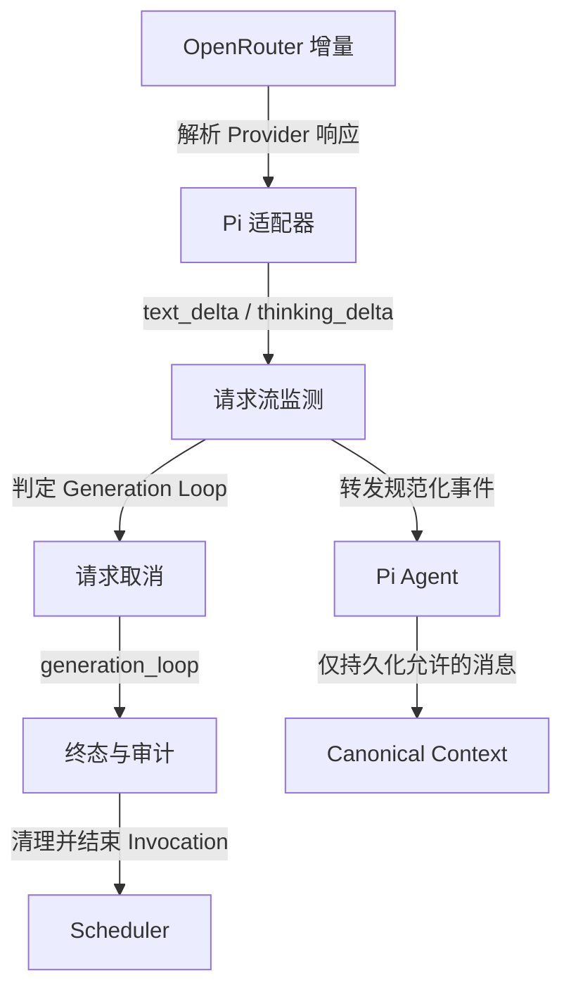

# Invocation #8064：Generation Loop 调查与第一版防重复熔断器方案

调查日期：2026-11-02。时区：Asia/Singapore（UTC+8）。

本文作为后续 Agent 会话的研究依据，未实现 Runtime 熔断器。第一版候选范围见 G，回归验收见 H；实现前仍须核对当前源码与用户指令。

建议：在单次模型请求的增量流中，同时检测 thinking 和普通 Assistant text。第一版用精确周期重复中止生成，近似重复先记录指标。

调查阶段完成线上只读查询、离线统计和源码核对，未修改业务代码或线上数据，未调用模型重放，也未编写 Runtime 检测器或测试实现。报告不包含聊天正文、用户身份、Prompt 或私有推理原文。

## A 核心事实与证据范围

| 项目 | 观察到的事实 |
|---|---|
| Invocation | #8064；运行 1,800.054 秒，约 30 分钟 |
| 起止时间 | 2026-11-02 19:31:32.856 → 20:01:32.910，UTC+8 |
| 最终状态 | `state=aborted`；`completion_reason=timeout`；Invocation 的 `error_code=null` |
| 模型 | 全部 37 条模型调用审计均为 `openrouter / deepseek/deepseek-v4-flash-0731`，role 为 agent |
| 模型调用状态 | 36 条 success；最后 #46815 为 error，`error_code=model_aborted` |
| 工具与发布 | 10 次 send 调用：7 次成功、3 次被 send_barrier 拦截；7 条成功发送审计 |
| Harness | 10 条发送提醒；其中 #51 长文本之前有提醒。先后关系不证明提醒导致循环 |
| 当前配置佐证 | active 配置 hash 与 Invocation 的 config_hash 相同；Provider API 为 openai-completions |
| 模型配置 | context_window=1,048,576；max_tokens=131,072；reasoning=true |
| Thinking 设置 | 目标 Chat 覆盖为 max，优先于全局 off；这不是从生成长度反推的结论 |
| 现有上限 | max_wall_clock_seconds=1,800；turns_per_injection=24；idle_grace_seconds=60 |
| 原始报文 | 37 条 request_json / response_json 均为 null；duration_ms 均为 null |

**Private Reasoning 是面板对普通 Assistant 私有文本的标签，不等于 Provider 的 thinking 字段。** 本次最早的大段异常位于 `thinking_text`，后续大段异常主要位于 `text`。只监控 reasoning 会漏掉最昂贵的部分。字段映射见 [面板展示代码](../../apps/admin-next/src/components/invocations/timeline-cards.tsx#L238) 和 [消息记录代码](../../src/orchestration/agent-runtime/run-hooks.ts#L145)。

| Token 口径 | 已记录数值 |
|---|---:|
| input_tokens，扣除已单列的缓存读取 | 315,659 |
| cache_read_tokens | 2,265,984 |
| cache_write_tokens | 0 |
| output_tokens | 208,789 |
| 合计 total_tokens | 2,790,432 |
| total_cost 审计值 | 0.045067736816 |

合计是 37 次调用累计值，不能当作一次上下文大小或生成 Token 数。七个异常片段所在调用共记录 198,808 个输出 Token，但该数也包含同次调用其他输出。CLI 未单列 reasoning Token 用量。

**最后 #46815 已保存 119,718 字符私有文本，用量却为 0。这里的 0 不能解读为没有消耗。** 它在收到完整用量前被中止，是与适配器默认零值、结束时接收 usage 的行为一致的解释；真实消耗及最终账单未取得。

#46787 记录了恰好 131,072 个输出 Token，与配置上限一致。这强烈提示触及输出上限，但 CLI 没有返回该调用的 finish_reason，不能写成已证实的 length 结束。现有审计把非 error / aborted 的终态记为 success，success 不保证正常、健康地结束。[状态映射](../../src/orchestration/agent-runtime/observability.ts#L190)

执行范围仅为 `surowan-utils doctor --json`、`invocation get 8064 --json`、`models list --json`、`config show --json`。四项退出码均为 0，stderr 均为空，doctor 返回 ok。全部原始响应只用于内存分析，落盘材料仅含脱敏报告与统计。

## B 异常怎样演变

下表的“字符”均为 **Unicode 码点**，不是模型 Token，也不是 CLI / HTTP chunk。对本次所分析片段，码点数恰好等于 JavaScript UTF-16 长度；这不应推广到含 emoji 的其他样本。区间使用 **从 0 开始、左闭右开** 的位置，包含空格、换行与标点。

模型调用与 Assistant 消息按顺序和相邻完成时间对应；CLI 没有提供两者的显式外键。表内耗时由 created_at / finished_at 相减得到，不是缺失的 duration_ms。

| 调用 / 消息序号 | 开始时间 UTC+8 | 异常字段 / 字符数 | 耗时 / 已记输出 Token | 演变特征 |
|---|---|---|---|---|
| #46766 / #22 | 19:33:57.571 | thinking_text / 18,338 | 49.201 秒 / 8,434 | 前段近似重复；末尾变成 3 字符短周期 |
| #46780 / #43 | 19:37:46.723 | text / 4,323 | 16.996 秒 / 2,270 | 混合短词与变化片段；只有短暂精确重复 |
| #46782 / #46 | 19:38:20.959 | text / 1,835 | 7.492 秒 / 1,098 | 近似重复再次出现，没有稳定长连串 |
| #46784 / #49 | 19:38:48.714 | text / 24,926 | 61.757 秒 / 10,964 | 形成 413、471 字符的局部长周期 |
| #46787 / #51 | 19:39:50.491 | text / 243,855 | 712.903 秒 / 131,072 | 从变体段落收敛到 163 字符周期，尾部极稳定 |
| #46801 / #54 | 19:52:33.404 | text / 101,593 | 240.847 秒 / 44,970 | 更长的 1,380 字符周期，中间夹少量变化 |
| #46815 / #57 | 19:56:57.865 | text / 119,718 | 275.030 秒 / 未完整计量 | 351 字符周期反复中断、恢复，最终被 Invocation 超时终止 |

这不是一条连续生成流。第一次退化之后存在短调用和工具活动，后期也有成功 send。Invocation 的长期存活，使一次生成退化能够与后续调用交替出现。

对所有 Assistant 的 text / thinking_text 分开检查，共 74 个字段，其中 66 个非空。识别出的七个大段退化片段共 514,588 字符。三个终止词 `quiet`、`done`、`完毕` 在 #22 中分别出现 993、916、1,167 次；在 #51 中分别出现 10,739、10,577、30,720 次。单个词出现频繁只是症状，不能作为黑名单规则。

| 片段 | 已核验的精确周期 | 最大代表区间 | 区间字符数 | 完整周期 + 尾段 |
|---|---:|---|---:|---|
| #22 thinking | 3 | [17,129, 18,338) | 1,209 | 403 次 |
| #49 text | 471 | [21,358, 23,600) | 2,242 | 4 次 + 358 字符 |
| #51 text | 163 | [29,521, 243,855) | 214,334 | 1,314 次 + 152 字符 |
| #54 text | 1,380 | [52,982, 79,288) | 26,306 | 19 次 + 86 字符 |
| #57 text | 351 | [40,696, 64,212) | 23,516 | 66 次 + 350 字符 |

这些区间逐字符验证通过。离线穷举周期范围为 1–2,048 字符；“代表区间”不表示已经排除更大周期。#49 还存在 413 字符周期的 4 次完整重复。

**长周期与近似重复同时存在。** #51 的主段落为 161 字符，加两个换行构成 163 字符周期。全段累计有 1,367 个完全相同的非空段落；另有 18 个段落与主段落的 Levenshtein 距离为 3 或 5。累计段落数不能当成连续重复次数。末尾稳定周期覆盖该字段约 87.9%。

#22 的退化更渐进：前 1,024 字符的 8-gram 冗余度约 56.7%；[7,168, 8,192) 达 84.2%；末尾则成为严格短周期。它在开头约第 55 字符就出现终止词，但这还不足以判定循环。

## C 最早什么时候可以判定

这里比较两条**离线候选规则**。阈值用于说明样本表现，尚未完成正常语料校准。

**精确规则 E：** 在同一次调用、同一字段中，查找周期 p=1…2,048 的连续精确重复；要求持续长度至少为 max(256, 8p)。即至少 8 个周期，并至少持续 256 字符。

**近似指标 N：** 按字段起点对齐，切成不重叠的 1,024 字符窗口。每窗计算 R = 1 − 不同 8-gram 数 / 1,017。连续三个窗口 R≥0.8 才报警。它衡量局部冗余，不声称找到了确定周期。

| 消息片段 | E 首次达到阈值时，已收到字符数 | N 首次报警时，已收到字符数 |
|---|---:|---:|
| #22 thinking | 17,385，p=3 | 10,240 |
| #43 text | 未触发 | 未触发 |
| #46 text | 未触发 | 未触发 |
| #49 text | 未触发 | 4,096 |
| #51 text | 25,286，p=163 | 3,072 |
| #54 text | 64,022，p=1,380 | 6,144 |
| #57 text | 5,596，p=351 | 4,096 |

E 在七个片段中命中四个，N 命中五个。E 的 #51 首次命中来自较早的 [23,982, 29,522) 重复段，不是表 B 的最长尾段。

**对本案例，最早有强精确证据的保守止损点，是 #46766 的 thinking 已收到 17,385 字符时。** N 可以把可疑点提前到 10,240 字符，但本次没有长度达到 3,072 字符的正常字段可作为 N 的有效阴性对照。不能据“本次没误报”声称 N 已可靠。

E 对其余 16 个长度至少 256 字符的非异常字段没有触发。这个对照规模仍不足以估计线上误报率，也不能证明上述阈值最优。

**无法把这些字符位置换算成准确时间或 Token 位置。** CLI get 返回聚合记录，没有原始流、chunk 时间戳或 Token ID。只能把首个止损点定位在 19:33:57.571–19:34:46.772 这次调用内。在线检测还会受到已到达 chunk 大小和缓冲的影响。不能将字符节省比例当成计费或耗时节省比例。

## D Runtime 可以在哪里检测和干预

上图中的“请求流监测”和 generation_loop 原因为建议新增部分。

| 层 | 当前行为 | 适合的用途 / 限制 |
|---|---|---|
| CLI / Admin 详情 | 读取完成或部分保留的审计文本 | 适合事后分析；不能据此取得历史 Token 流 |
| `bindRequestHooks` | 拿到 model-call ID，调用 streamSimple，结算 usage，释放模型并发额度 | 推荐放置单次请求检测与取消的控制边界 |
| Pi 规范化流 | 提供 text_delta、thinking_delta、contentIndex、终态 | 推荐检测输入；不依赖某个 Provider 的原始字段 |
| `subscribeRunEvents` | 能收到 message_update，目前业务逻辑主要处理 message_end / turn_end | 可做监测入口；但单独挂监听器不足以保证取消和审计顺序 |
| `finishTurn` | 在生成结束后检查预算、重复工具失败、发送提醒、注入与 idle grace | 对单次生成内的无限输出太晚 |
| Scheduler / finish | 落 Invocation 终态、释放未注入 Bucket、清理运行状态 | 应复用现有收尾，不新增调度器 |

代码依据：[请求与审计钩子](../../src/orchestration/agent-runtime/run-hooks.ts#L22)、[轮次边界](../../src/orchestration/agent-runtime/run-turns.ts#L106)、[超时 Signal](../../src/orchestration/agent-runtime/run.ts#L87)、[收尾](../../src/orchestration/agent-runtime/run-finish.ts#L21)、[Scheduler](../../src/orchestration/scheduler/execution.ts#L75)。

**取消存在一个必须处理的接线问题。** 生产路径在展开 options 后，又用 scope.signal 覆盖 options.signal。因此只调用 agent.abort()，并不能保证把取消传给正在读取网络的 Provider。应将检测取消、Invocation 超时、Scheduler 取消以及 Agent 自身 signal 合并后传下去。项目 replay 路径已经有合并 signal 的做法可参考。[生产路径](../../src/orchestration/agent-runtime/run-hooks.ts#L39) / [replay 路径](../../src/orchestration/replay/run.ts#L195)

**不能另外启动第二个 for-await 消费同一事件流。** 当前 EventStream 使用共享队列，多个消费者会分走事件。若采用请求流包装，应只有一个上游消费者，并把事件转发给 Agent；审计应等待包装后的最终结果。事件流实现（`node_modules/@earendil-works/pi-ai/dist/utils/event-stream.js:26`，安装锁定依赖后可读）

还有一个结束竞态：Provider 可能已经把 done 放入队列，而检测器正在处理前面的 delta。现有原始 stream.result() 会提前结算。只在监听器里 abort，可能留下 success 审计或继续执行工具。检测决策、包装后的终态、审计和工具放行必须共享一次性状态，不能各自判断。

**Context 也是止损的一部分。** 当前 error / aborted Assistant 不进入 canonical history，成功消息会进入。应复用此边界，避免中止片段进入后续上下文，并让缓存失效后从 canonical history 重建。[编码规则](../../src/context/codec.ts#L136) / [缓存清理](../../src/orchestration/agent-runtime/run-finish.ts#L67)

本样本 #46787 的计量输入为 66,011 Token，下一次 #46795 升到 199,898。结合当前源码，成功的异常长文本被后续上下文携带是一种有依据的解释。CLI 的 context_messages 是冻结消息快照，不能证明完整 canonical history 的实际内容，也不能把所有增长都归因于循环。

## E Provider 能否返回推理并接受中止

| 问题 | 结论与证据等级 |
|---|---|
| 本次是否取得了 thinking？ | **事实：是。** agent_messages.thinking_text 非空，#22 有 18,338 字符 |
| OpenRouter 是否支持流式 reasoning？ | **官方能力：是，视模型及下游而定。** 支持 reasoning 与 reasoning_details；加密或不公开的推理不可按明文检测 |
| 当前 Pi 能否产生 thinking_delta？ | **源码事实：是。** 优先读取 reasoning_content、reasoning、reasoning_text 中首个非空字段，避免同时存在别名时重复计入 |
| reasoning_details-only 是否也变成文本 delta？ | **当前版本限制：不会。** 该分支保存为 thinkingSignature，没有直接产生同等明文 thinking_delta |
| 能否主动中止本地请求？ | **源码支持，线上 timeout 也有结果佐证。** AbortSignal 传给请求，适配器返回 aborted |
| 中止后上游是否立即停止生成和计费？ | **未对本次路线实测。** 官方列出 DeepSeek 为支持取消的 Provider，但 OpenRouter 模型名不等于实际下游路由 |

官方依据：[Reasoning Tokens](https://openrouter.ai/docs/guides/best-practices/reasoning-tokens)、[Streaming 与取消支持](https://openrouter.ai/docs/api_reference/streaming)。这些页面说明的是当前公开能力，不是 #8064 的网络抓包证据。

本地固定依赖为 pi-ai / pi-agent-core 1.1.0。适配器在请求时使用 signal；将普通 content 变成 text_delta，将明文 reasoning 变成 thinking_delta；中止时保留部分内容并返回 aborted。请求（`node_modules/@earendil-works/pi-ai/dist/api/openai-completions.js:192`，安装锁定依赖后可读）、增量解析（`node_modules/@earendil-works/pi-ai/dist/api/openai-completions.js:382`，安装锁定依赖后可读）、reasoning_details（`node_modules/@earendil-works/pi-ai/dist/api/openai-completions.js:455`，安装锁定依赖后可读）、中止处理（`node_modules/@earendil-works/pi-ai/dist/api/openai-completions.js:491`，安装锁定依赖后可读）。

只有 reasoning_details 的明文内容，可考虑以后通过适配器支持扩展覆盖；必须避免与 reasoning 别名双计。加密内容不可解读，不能据“看不见重复”判定正常。

本次没有 Provider generation ID、实际下游、原始 finish_reason、逐块记录或账单。37 条审计的 attempt 都为 1，但 startModelCall 固定写 1，底层还允许请求重试；所以也不能据此证明没有 HTTP 重试。

源码结论基于本地 develop 的 `2f393f28b0ec95d68086517814d769034dc24a87`。线上配置 hash 一致，不等于线上二进制与本地提交完全一致。

## F 检测算法的取舍

| 方法 | 本案例价值 | 成本与局限 | 误报来源 |
|---|---|---|---|
| 精确连续周期 | 能明确识别 3 / 163 / 351 / 1,380 字符循环，证据可复核 | 变一个字就会打断；只查短周期会漏掉段落周期 | 正常复述、刻意重复、模板和重复代码 |
| 滚动哈希 | 加速重复片段候选查找或窗口比较 | 它是匹配加速方式，不是循环判据；仍需长度、次数、连续性规则及字符复核 | 哈希碰撞；非连续引用被误当成连续循环 |
| 多尺度窗口 | 同时覆盖短词、句子和段落；减少固定窗口盲区 | 阈值随窗口大小变化；重叠窗口不能当独立证据 | 表格、枚举、规则化日志长期低多样性 |
| 8-gram 冗余 / 相似度 | 在 #22、#49、#51、#54、#57 中更早提示退化 | 不保证存在周期；窗口越大越容易显得冗余 | 有限词汇任务、重复格式、技术文档 |
| 编辑距离 / 局部对齐 | 能解释 #51 段落增删 3–5 字符的变体 | 需要先找候选与对齐；全流计算昂贵，分段不稳定 | 正常修订、比较两个相似方案 |
| 语义相似度 | 理论上覆盖改写式循环 | 本样本不需要引入额外模型、Embedding 或依赖 | 合理的反思、纠错和总结 |

**最低风险的判断对象是“持续的新输出缺少变化”，不是某个结束词。** 规则不能依赖 quiet / done / 完毕，也不能把正常多轮里相同短回答拼成一次循环。

字符保留大小写、标点和换行，便于复核。去标点、折叠空白可以另作近似指标，但不应直接据此自动中止。只计算压缩率或词汇熵也不足以区分合法规律文本。

输出 Token 上限和时间上限仍应保留。降低上限能缩小损失，却不是循环检测，也可能截断合法长推理。本次不建议仅凭单个样本改线上阈值、Prompt 或采样参数。

## G 建议的最小可行实现

**第一版：精确循环负责中止，近似重复仅观测。** 阈值先作为回归和影子观察的候选值；完成正常长文本校准后再启用自动中止。无需新增外部服务或依赖。

| 范围 | 建议契约 |
|---|---|
| 入口 | 放在 bindRequestHooks 的单次模型请求流边界；仅消费规范化 text_delta / thinking_delta |
| 状态隔离 | 按 model_call、通道和 contentIndex 分开；新请求和新内容块重置，不跨 Invocation 叠加 |
| 精确判据 | 周期 1–2,048；连续长度 ≥ max(256, 8p)；不使用结束词名单 |
| 纯格式文本 | 纯空白或分隔符周期先只观测；自动中止候选周期至少含字母、数字或文字字符 |
| 最简计算方式 | 为各候选周期维护连续相等长度；与 p 字符前比较。无需先引入哈希或编辑距离 |
| 资源边界 | 只需有界字符环和计数器；时间为 O(2,048 × 新字符数)，空间为 O(2,048)，每通道独立 |
| 性能取舍 | 并发吞吐尚未测量；若实际 CPU 超预算，再增加候选筛选 / 滚动哈希，并逐字符复核 |
| 取消 | 设置不可逆的本地 loop 判定，再 abort 合并后的请求 signal；终止本次 Invocation |
| 终态 | 建议 Invocation 为 aborted / generation_loop；model_call 为 error / generation_loop |
| 工具 | 不执行中止消息里的工具调用；不继续 nudge、同请求重试或自动重放 |
| Context | 中止消息按 aborted 处理，不写 canonical history；缓存、header、head_seq 和 refs 遵守既有收尾规则 |
| 已发生副作用 | 保留已成功 send 的真实审计；不能把整次 Invocation 写成“未发送” |
| 隐私 | 检测在内存进行，不依赖 record_agent_thinking 开关，不新增推理正文日志 |

字符检测必须跨 chunk 延续；UTF-16 代理对跨边界时保留待续状态。心跳、usage、finish_reason、text_end 的累计文本不能当成新字符再喂一次。两种通道不相互拼接。

建议沿用现有 error_code、completion_reason 和 error_detail，记录结构化的最小证据：算法版本、通道、contentIndex、已观察字符数、周期、持续长度、重复次数和采用阈值。不要保存循环正文。中止用量要标明不完整；本地 generation_loop 也不能冒充 Provider 的原始 finish_reason。

真正接入时，必须让检测后的终态成为唯一结算依据。即使上游已排队 done，也不能让原始 result() 抢先记 success。并发额度释放、终态审计和取消应各执行一次，未注入的 Bucket 继续走现有释放路径。

这一版本能截住本案例的首轮精确退化，且覆盖后期三种主要精确周期。它会漏掉 #43、#46、#49 的部分近似退化；这个已知限制，比未经校准就按相似度中止所有长文更容易验收。

## H 回归样本设计与待验证事项

所有测试材料使用合成文本，保留周期、长度、变异位置和通道结构。不把生产聊天或私有推理提交进仓库。本次仅归档 Markdown；上表保留构造合成回归样本所需的量化结果，不依赖会话外的临时文件。

| 样本组 | 构造 | 必须断言 |
|---|---|---|
| 短循环 | 无关前缀后接 3 字符单元 ×403；分别放进 thinking / text | p=3，满 256 字符持续区后触发；两个通道都生效 |
| 中周期 | 163 字符单元；33 次、单点变异、再 1,314 次 +152 字符 | 变异重置；累计次数与连续次数分开 |
| 长周期 | 351 ×66 +350；1,380 ×19 +86；包含非整周期尾段 | 覆盖 >256 的周期；不能只依赖换行 |
| 短暂重复 | 413 / 471 字符单元各重复 4 次后继续正常内容 | 在 E 的 8 次阈值下不自动中止 |
| 近似退化 | 对段落插入、删除、替换 3–5 字符；周期逐步漂移 | N 可观测；未达到精确规则时不误记自动中止 |
| 真正阴性长文 | 长于 16,384 字符的推导、纠错、代码、表格、双语对照、日志、刻意复述 | 测量误报；明确合法重复任务的可接受策略 |
| Chunk 不变性 | 同样文本按 1 字符、随机长度、大块、跨周期边界切分 | 相同字符触发位置；chunk 数不影响结论 |
| Unicode / 边界 | 中文、emoji、组合字符、跨代理对、空白和纯分隔符 | 单位一致；无边界损坏；空事件不增长计数 |
| 事件语义 | 重复的累计 partial、thinking_end、usage、重复 finish_reason、reasoning 双别名 | 只消费真实增量，不重复喂入 |
| 取消竞态 | 检测命中与 done / timeout / shutdown 同时发生 | 实际请求 signal 被取消；唯一终态；无后续工具或 nudge |
| 用量缺失 | 中止前没有 usage；中止前仅部分 usage | 不宣称免费；保留已知用量并标不完整 |
| 状态恢复 | 中途已有 send，随后循环；并有未注入 Bucket | send 审计正确；Bucket 释放一次；缓存清理、canonical history / head_seq / refs 一致 |
| Provider 差异 | 明文 reasoning、仅 reasoning_details、加密推理 | 检测覆盖如实标记；不可见不等于无循环 |
| 保密开关 | record_agent_thinking 开启 / 关闭 | 检测效果相同；关闭时不新增推理正文存储 |

可复用项目现有 Faux Provider、[Agent 测试设施](../../test/agent/runtime.test.ts#L1) 和 [Context 编码断言](../../test/context/store.test.ts#L124)。验收不能只检查返回 reason，要检查 model_calls、Invocation、工具、Bucket、canonical history 和并发额度释放。

仍需验证：正常长文本误报率；多会话并发 CPU 成本；当前线上构建对应的提交；实际下游路由的取消延迟和计费截止；只有 reasoning_details 时的真实覆盖。带真实 Provider 的取消实验需要另行授权一次明确的计费调用，本次未执行。

尚不能确定的根因包括：模型自身退化、Prompt / 上下文诱导、重复历史的放大、Provider 流异常。保存后的周期性文本足以证明运行时需要识别退化，但没有原始 SSE，不能排除上游重复增量；不能把任一根因写成已证实。

调查阶段未运行仓库测试或性能基准，因为未修改实现。离线统计已检查全部 Assistant 字段，并对代表周期区间做逐字符复核。第一版实现留待后续开发会话。
