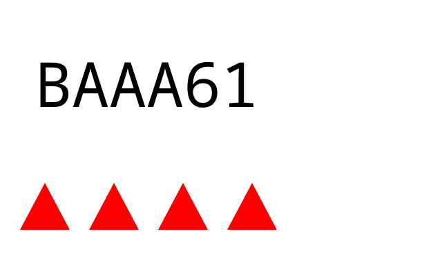
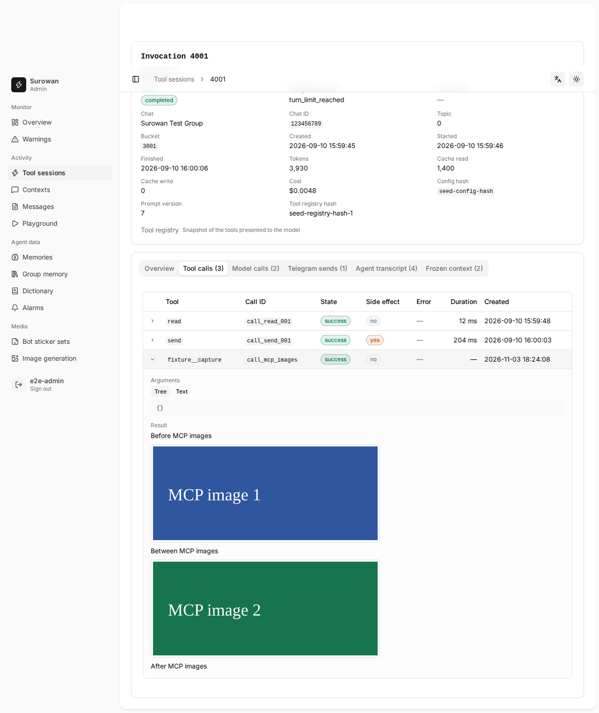
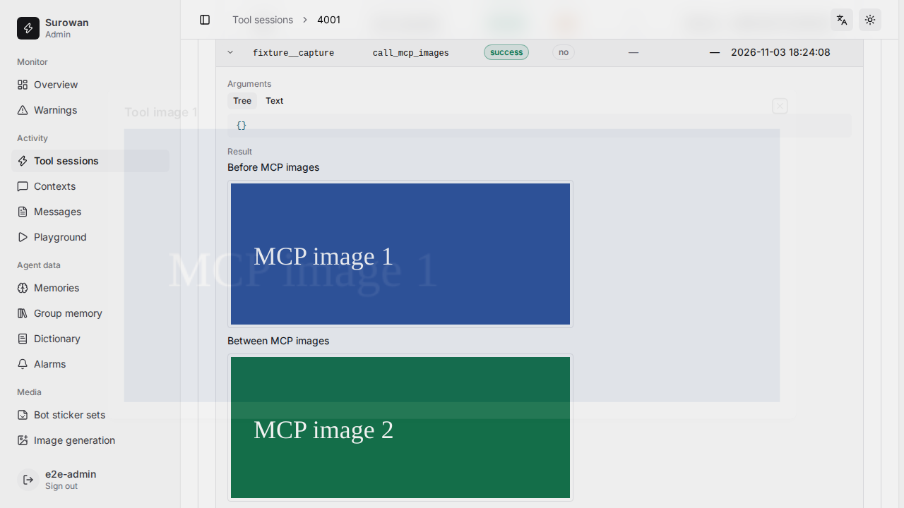
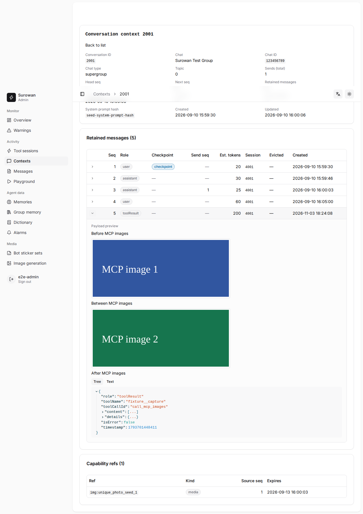

# MCP 原生图片支持与验证记录

基线：`develop` / `932612cf8fc0d354ae4bc29f074e9bd1fecbaf8b`。验证环境为 Fedora 43、Node 24.22.2、pnpm 12.11.2。Surowan 服务与业务数据均使用临时目录隔离；真实视觉验收通过本机已有 tiny-magpie 的合法模型路由发起两次请求，没有连接 Telegram 或向外部聊天发送消息。

## 实现边界

原生 MCP `image`、纯图片、混合文本、多图和 `isError` 图片结果使用已有本地图片资产存储。canonical history 保存有版本的引用及结果位置；每次请求从 retained history 授权并加载图片字节，缓存和 SQLite 文本不持有 base64。Completions 仅在请求投影中把图片转成逐图带原始工具名/call ID 的 user 内容；canonical 工具身份不变。

Admin 工具审计、时间线、Transcript 和 Context 使用认证图片 URL 显示真实像素并放大。图片 GET 仅供 Panel Session，Bearer key 不自动取得新的媒体权限；Context 读取不依赖 Invocation 审计仍然存在。

没有新增图片生命周期服务、定时器或一组新配置。复用 `PlaygroundAssetStore` 的现有目录、格式校验、私有文件、去重和 staging grace；旧的 table/directory/class 名保留，MCP 也使用该存储，不开放 Playground MCP。清扫同时检查输入 media、工具审计和 canonical 引用；复用旧资产会续期 staging grace。cut 撤销模型读取，仍被历史记录引用的资产继续保留。

迁移 050 只增加 nullable 字段：`tool_calls.result_content_json`、`agent_messages.tool_call_id`、`playground_assets.last_used_at`。旧纯文本 MCP 保留原 JSON 包装与截断行为，旧工具历史可不含 details，新字段为空时使用原文本展示。

边界沿用已有配置和处理能力：MCP `payload_max_bytes` 配置及最大 1 MiB 不变；本地资产最多 10 MiB、40M 像素；规范化最长边 2048、JPEG/PNG 输出；请求加载工具图片共用现有 20 MiB 媒体字节预算，预先扣除 transcript 内全部已有图片的解码字节与数量，并遵守模型声明的每请求、每消息图片数量。连续 tool results 按 Pi adapter 的实际分组共用消息额度：Completions、Anthropic、Gemini 3+ 合并；Responses 与 Gemini 2 图片输出各自计数。原生数据严格校验 base64、静态 JPEG/PNG/WebP 的 MIME/魔数和可解码内容。传输超限报告 `payload_limit`；格式错误、缺图、请求预算和不支持图片的模型均明确反馈，不自动重发工具或调用辅助 vision。

不包含 resource/link 抓取、音视频、动画、Telegram 主动发图、自动换模型或自动辅助视觉。现有 1 MiB wire 上限意味着部分大截图会被明确拒绝，这是保留的兼容约束。

## 自动验证

| 验证 | 覆盖 |
| --- | --- |
| `test/mcp/images.test.ts` | 真实 stdio MCP、混排顺序、多图、纯图、isError、旧文本包装、缺图、无视觉能力、越权、cut、审计过期、清扫及 staging grace |
| `test/mcp/image-limits.test.ts` | stdio/Streamable HTTP 真实运输、native image、HTTP/stdio payload 超限、base64/MIME/大小拒绝及模型图片数量限制 |
| `test/mcp/providers.test.ts` | 四个真实 Pi adapter 经隔离 HTTP fixture 发出请求；Completions 多工具/复合 call ID、Responses 图片 output、Anthropic 错误图片结果、Gemini 2/3 格式；四种 wire 图片脱敏 |
| `test/agent/runtime-mcp-images.test.ts` | AgentRuntime → stdio MCP → canonical → 请求加载；关闭后重新打开 SQLite、创建新 Runtime，恢复相同图片字节与错误状态；工具调用身份审计 |
| `test/admin/tool-images.test.ts` | Session 认证、Bearer 拒绝、PNG 字节、nosniff/private/no-store、错误工具/Invocation/资产拒绝、带分隔符的 call ID、审计删除后的 Context 读取、缺文件 |
| `test/schema/migrations-mcp-images.test.ts` | 从 048 升级，保留旧工具文本、无 details 的历史和原本地图片元数据，验证外键一致性 |
| `test/context/store.test.ts`、`test/models/request-audit.test.ts` | 旧历史可读；data URL、Anthropic source.data、Google inlineData.data 脱敏且不误删普通 data 字段 |
| Admin E2E `23-mcp-images` | 真实 AdminServer、SQLite、生产 SPA/CSP、真实图片加载 naturalWidth、混排、放大、Transcript/Context 和刷新恢复 |

仓库检查命令：

```sh
pnpm run check
pnpm run lint
pnpm test
pnpm run admin:build
pnpm run admin:test:e2e 01-routes 03-invocation-detail 05-readonly-security 06-trust-boundary 23-mcp-images --workers=2
```

初始实现执行结果：MCP 图片相关 **23 项测试通过**；上述五组 Admin E2E **43 项全部通过**；`check`、`lint`、Admin 构建通过。冷恢复测试还单独验证了先停止 MCP、关闭原 SQLite，再打开数据库并创建新 Runtime 的路径。迁移断言已同步为版本 049 及新增字段的明确 null 值。

本轮 P2 修复后，完整套件 **363 文件 / 2015 项全部通过**（482 秒）；随后对最终 Provider 分组边界调整再运行受影响的 **8 文件 / 45 项全部通过**。最终 `pnpm run check`、`pnpm run lint`、`git diff --check` 通过。本轮没有修改 Admin UI/API，沿用上述已通过的 43 项 E2E。

完整套件共 **363 个测试文件、2,008 项**。曾有一轮全部通过；最后对业务提交 `c782f700e731b1673b9e9863f355ebec33b0fb4b` 的完整复跑为 **2,007 通过、1 失败**，失败是既有的 `test/playground/context.test.ts:198`（`a room memory list hides the oldest entries to fit its 10% budget`）。使用原始基线 `932612cf8fc0d354ae4bc29f074e9bd1fecbaf8b` 的隔离源码连续运行该测试 8 次，复现 1 次相同失败：快速创建的记忆可能拥有相同毫秒时间，存储再按随机 ID 排序，测试却要求最后创建的 `9` 一定保留。本次未修改这个无关的记忆模块或测试，没有通过重试把该项记成通过。

Provider fixture 有意在收到请求后返回 400 终止，因此它证明真实 adapter 的 wire 契约，不代表真实供应商接受或理解了图片。fixture 的 `image-model`、`claude-sonnet-4`、`gemini-3-flash` 和 `gemini-2.5-flash` 是用于选择适配路径的测试 ID，不能据此宣称这些真实模型已验收。

## 三项 P2 修复与清扫 SQL 证据

1. 请求投影在恢复引用前预扫描所有已有 ImageContent，统一预留数量和解码字节；按实际 Provider 合并消息约束恢复，超限保留明确说明，不重试工具、不改成功审计。回归覆盖用户图片与 MCP 混合、字节耗尽、多个工具共享单消息额度、独立消息的额度隔离。
2. 清扫改为单条 `DELETE ... RETURNING`，以排除 NULL 的 `UNION` 一次提取 canonical/audit 引用集合，保留同一 SQLite 语句内的原子引用检查。没有引入引用表或新的媒体生命周期。删除语句是过期资源的认领时点；此后即使文件仍待删除，新提交也由原有 admission 事务拒绝为 `unknown_asset`。测试验证删除前刚提交的 media/context/audit 引用得到保留，以及认领后两个提交入口均拒绝且不产生悬空 media。文件清理中断留下的字节由已有 orphan sweep 回收。
3. 每次请求投影只读取一次当前 conversation 的 retained toolResult，构造 call ID → 引用表；不再为每个结果运行未索引的 JSON call ID 查询。测试断言多工具仅一次历史查询，并覆盖 conversation、call、asset/位置、chat、evicted_at 与 head_seq 边界。

修改前先取得真实 SQL 计划：[旧 SQL/计划](sweep-before.json)、[新 SQL/计划](sweep-after.json)。Fedora、SQLite 3.53.4 的有界合成数据为 1000 个过期资源、2000 条 context 和 2000 条 audit，每条两项 JSON。旧 SELECT 约 **1568.448 ms**，出现两个 `CORRELATED SCALAR SUBQUERY` 和逐资源 JSON 扫描；新 DELETE RETURNING 约 **3.898 ms**，使用一次 `LIST SUBQUERY`/`UNION` 临时 B-tree，仅保留有索引的 media 相关查找。旧数值不含后续逐资源删除检查；这是单次有界实验，不能视为生产延迟承诺。

## 真实视觉与新进程恢复：通过

2026-11-03 在 Fedora 上先核实 tiny-magpie 磁盘及运行版本均为 0.3.2，再更新至官方稳定版 [tiny-v0.3.3](https://github.com/caelis-labs/tiny-magpie/releases/tag/tiny-v0.3.3)。安装及实际运行二进制 SHA256 为 `d4039661c355d4954934421448e12ab5b9f6b37bca0d89d134edb8e96589baa1`，用户 systemd 服务 active/running、官方 healthcheck 通过，监听仍为 `127.0.0.1:3425`、`127.0.0.1:3430`。升级后立即比较账号文件、静态配置和 unit 未变；当时仅运行状态文件 affinity/served 变化，备份保留于主机私有目录。真实请求结束后再核对：仍为原来的两个账号，账号身份、home 和启用状态一致，logins 仅 seen 字段因正常使用更新。

入口为 `test/mcp/live-vision.ts`：临时 stdio MCP 生成随机六位码和独立随机颜色/形状/数量，工具只返回图片。停止 MCP、关闭初始数据库后，第一次请求问码；随后启动全新 Node 进程从 SQLite canonical history 恢复同图，再问此前未问的图形细节。首次答案不写入历史，两次请求都设置 `maxRetries: 0`。

实际路径为 `http://127.0.0.1:3425/v1/responses`、模型路由 **`codex/gpt-6-luna`**。2026-11-03 11:59:45–11:59:51 UTC，两次调用均正常停止且答案与图片完全一致：

| 请求 | 进程 PID（沙箱内） | 新问题 | 实际回答 |
| --- | --- | --- | --- |
| 初次 | 3 | 图中六位码 | `BAAA61` |
| 恢复 | 33，父 PID 3 | 此前未问的颜色、形状、数量 | `RED TRIANGLE 4` |



两次实际 payload 各含一张 8696 字节 PNG，SHA256 均为 `5308db125a1a40a94308fe2caf20b6849310f446e3d861141fe802de8fe8e125`。两次 canonical SHA256 均为 `3ed82843ae186f55bc5dd7776b0f3c2cfc10b9a9ba36460d524af2852224a916`，其中不含两个答案。

可核对的证据：[初次请求](live/initial.request.json)、[恢复请求](live/restored.request.json)、[初次结果](live/initial.result.json)、[恢复结果](live/restored.result.json)、[canonical history](live/initial.canonical.json)、[网关身份](live/gateway.json)、[网关请求账本](live/gateway-requests.json)。账本中的两条真实请求 route ID 为 `1793706814153` / `1793706814154`，均为 HTTP 200，provider=`codex`、requested=`codex/gpt-6-luna`、served=`gpt-6-luna`，时间与 token 数对应客户端结果。请求图片数据按现有审计规则替换为 MIME/字节数/SHA256，无授权 header 或账号信息；图像单独保留。served 是网关记录的上游回报身份，无法独立证明供应商内部部署；usage.cost 来自测试配置单价，不代表实际账单。

首次执行在配置校验阶段明确失败：`MCP server verify tool capture has no policy`，未发起模型请求。补齐该只读工具的逐工具 policy 后完成上述两次真实调用，没有重启或改动网关配置。原错误保留在主机 `/tmp/surowan-mcp-live-20261103.log`。

复现入口仍要求 `SUROWAN_MCP_IMAGE_TEST_{API,BASE_URL,MODEL,KEY}`，可设 `SUROWAN_MCP_IMAGE_TEST_EVIDENCE_DIR` 保留脱敏证据，再执行 `node test/mcp/live-vision.ts`。每次运行会产生两次真实模型请求；临时配置和 SQLite 在结束时清理，证据目录保留。

## 浏览器截图

截图使用合成数据，没有真实业务消息或凭据。






